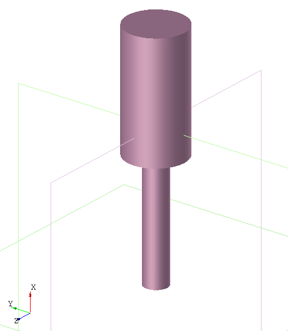
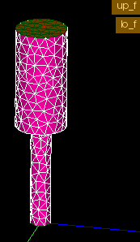
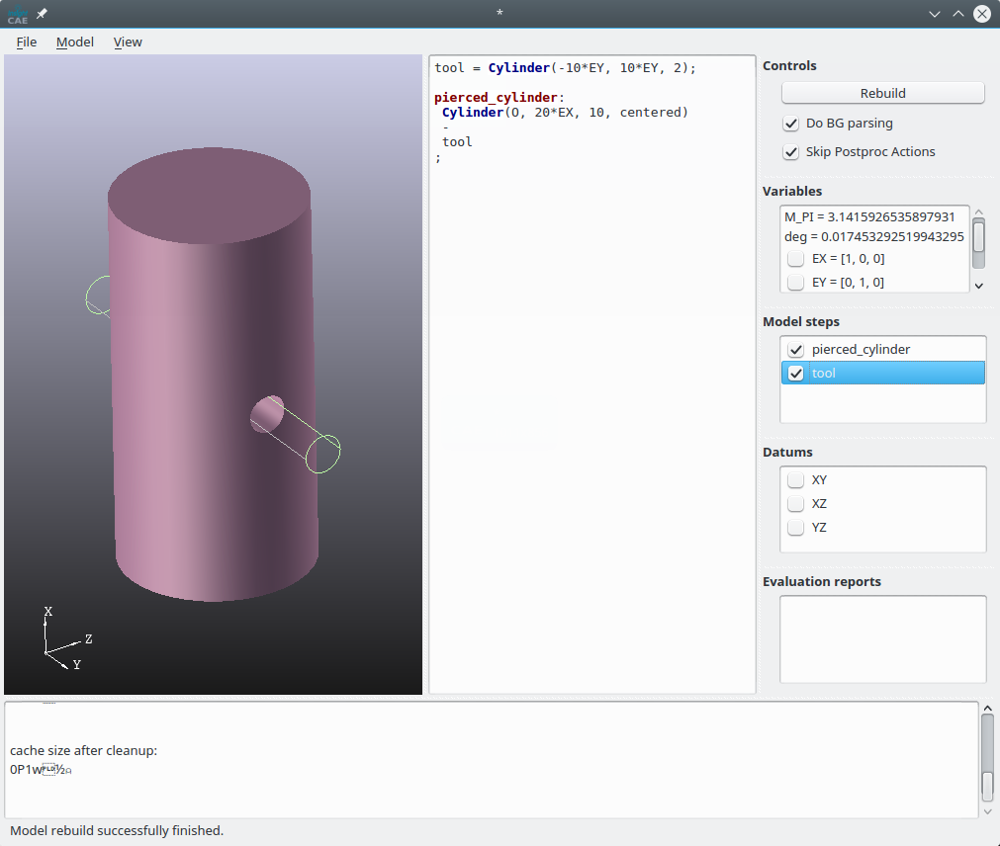
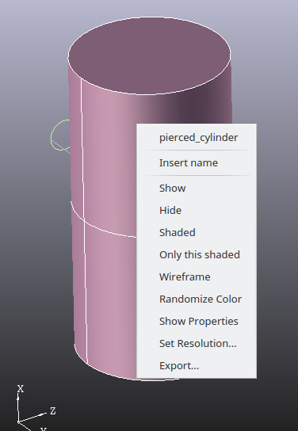
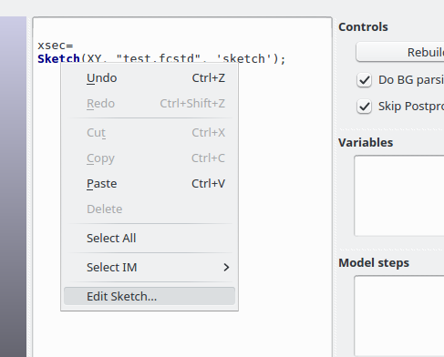
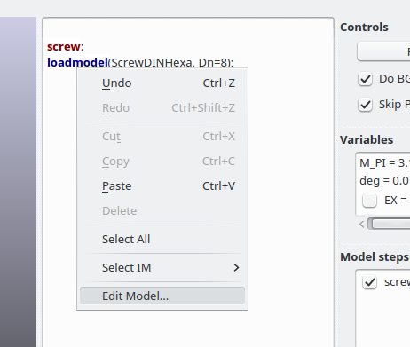

# InsightCAD — Script-Based CAD

## Introduction

InsightCAD is a script-based tool for creating three-dimensional geometry models. All geometric operations are based on the OpenCASCADE geometry kernel. It uses the boundary representation approach (BREP) for treating the geometry. Thus it is possible to import and export the common exchange formats IGES and STEP.

Although the primary intention of InsightCAD is creation of fully parameterized CAD models for systematic numerical simulations, it can also be used for mechanical design purposes. It therefore provides the possibility to export projections and sections of the created models in DXF format for use in drawings. Additionally, there is support for a library of parametric standard parts.

This page describes the script language and the graphical editor. The complete list of feature commands and postprocessing actions is given in the [command reference](iscad-reference.md).

## Basic Concept

The basic entity in InsightCAD is a "model". A model is described by a script and stored in an ASCII script file (extension ".iscad"). Inside a model script, symbols are defined, which can represent the following data types:

-   Scalars

-   Vectors

-   Datum objects (points, axes, planes)

-   3D geometry objects (features)

-   Selections of vertices, edges, faces or solids of 3D geometry objects

There is no explicit type declaration: the data type of each symbol is deduced from the defining expression.

Beyond their geometry representation, geometry feature objects are containers for scalar, vector, datum and feature objects. These symbols can be accessed in the model script but are read-only (see [Accessing feature properties](#accessing-feature-properties)).

In a model script, postprocessing actions can be used in addition to the symbol definitions. These can be e.g. file export, drawing export or others.

#### General CAD Model Script Syntax

A model script is a sequence of symbol definitions and postprocessing actions, which may be mixed in any order. Each symbol has to be defined before it is used.

```cpp
[cost <number>;]

<identifier> [ = | ?= | : ] <expression> [ '<description>' ];
...
<feature identifier> -> <property> = <value>;
...
@description '<text>' [ ( '<text>' ) ];
...
<postprocessing action>;
...

[@doc
  <documentation statement or postprocessing action>;
  ...
]
```

-   The optional `cost` statement at the very beginning assigns a cost value to the model. The total cost is reported after the model has been built.
-   Feature definitions can be followed by a description string in single quotes, e.g. `plate: Box(O, 100*EX, 50*EY, 5*EZ) 'base plate';`. The description is a comment only; it is currently not evaluated.
-   `@description` sets a description of the whole model, which is used e.g. when the model is loaded as a part into an assembly and a bill of materials is created. The optional second text in parentheses can hold additional details. A description text can contain printf-style placeholders, which are filled with scalar values listed after it, separated by `%`: `@description 'Screw M%g x %g' % d % L;`
-   Property assignments with `->` are described in [Feature properties](#feature-properties).
-   After the keyword `@doc`, [documentation statements](iscad-reference.md#documentation-statements) can follow. It has to be the last section of the script.

Former versions required the postprocessing actions to be placed in a section at the end of the script, started by the keyword "@post". This keyword is deprecated: it is still accepted, but ignored and a warning is issued.

Comments are lines starting with "#" or text regions enclosed by "/\*" and "\*/" (C-style).

Command names (feature commands, functions, postprocessing actions) are reserved and cannot be used as symbol names.

## Submodels and Subassemblies

It is possible to load another model into the current one by the "loadmodel" command (see the [command reference](iscad-reference.md#loadmodel)). In this case, the loaded model represents a subassembly, i.e. a compound of features. Since not all defined geometry objects in the submodel may represent assembly components, marking of components is supported by the feature definition syntax and needs to be utilized properly in the definition script of the submodel. Also, when loading models (subassemblies), parameters can be passed to the submodel. These can be scalars, vectors, datums or features.

Instead of loading a model from a separate file, a submodel can also be written directly inside the script, enclosed in curly braces ("in-situ submodel"):

```cpp
L = 100;

part: {
  w ?= 10;
  b: Box(O, L*EX, w*EY, w*EZ);
};
```

All symbols of the enclosing model are visible inside the submodel. As for a loaded model, only the features defined with ":" become components of the resulting compound, and all symbols defined inside are accessible from the result (e.g. `part.b`, `part$w`). In-situ submodels are also used as loop bodies in the [`for`](iscad-reference.md#for) command.

## Symbol Definition

### Scalars

Example:

```cpp
D ?= 123.5;
L = 2.*D;
```

The "?=" operator assigns a default value. This needs to be used for symbols which are intended to be used as parameters in the "loadmodel" feature command. Symbols defined by the equal sign operator ("=") cannot be overridden during the loadmodel command.

Supported operations are listed in the [table below](#tab:iscad_algebra).

| InsightCAD script | Description |
|---|---|
| `+ - * /` | basic algebra |
| `mag(<vector>)` | magnitude of vector |
| `sqrt(<scalar>)` | square root |
| `sin(<scalar>)` | sin(x) |
| `cos(<scalar>)` | cos(x) |
| `tan(<scalar>)` | tan(x) |
| `asin(<scalar>)` | arcsin(x) |
| `acos(<scalar>)` | arccos(x) |
| `atan(<scalar>)` | arctan(x) |
| `atan2(<scalar:y>, <scalar:x>)` | arctan(y/x) |
| `ceil(<scalar>)` | smallest following integer |
| `floor(<scalar>)` | largest previous integer |
| `round(<scalar>)` | round to next integer |
| `pow(<scalar:a>, <scalar:n>)` | a^n |
| `min(<scalar:a>, <scalar:b>)` | minimum of a and b |
| `max(<scalar:a>, <scalar:b>)` | maximum of a and b |
| `sgn(<scalar>)` | sign: -1 if x<0, else 1 |
| `pos(<scalar>)` | step function: 1 if x>=0, else 0 |
| `neg(<scalar>)` | step function: 1 if x<0, else 0 |
| `volume(<feature>)` | volume of feature |
| `surfacearea(<feature>)` | surface area of feature |
| `cumedgelen(<feature>)` | sum of all edges lengths |
| `circdiameter(<edge selection>)` | diameter of a circular edge |
| `cyldiameter(<face selection>)` | diameter of a cylindrical face |
| `TableLookup(<table>, <keycol>, <scalar:key>, <col> [, nearest])` | value from a table, see below |
| `<vector>.x` | x component of vector |
| `<vector>.y` | y component of vector |
| `<vector>.z` | z component of vector |
| `<vector> & <vector>` | Scalar product |
| `<feature>$<identifier>` | scalar property of feature |

**Table:** Algebraic operations in ISCAD scripts {#tab:iscad_algebra}

`TableLookup` reads the table `<table>.csv` from the model search path (see [loadmodel](iscad-reference.md#loadmodel)). The first line which does not start with "#" contains the column names; columns are separated by "," or ";". The function searches the row in which column `<keycol>` equals the key value and returns the value of column `<col>`. If the keyword `nearest` is given, the row with the closest key value is used instead of requiring an exact match. Table and column names are given as identifiers:

```cpp
# reads screws.csv with columns d, k, s
head_height = TableLookup(screws, d, 8, k);
```

There are scalars predefined in each model. They are included in the [table of predefined symbols](#tab:iscad_datums).

### Vectors

Example:

```cpp
v ?= 5*EX + 3*EY + [0,0,1];
ev = v/mag(v);
```

The "?=" operator assigns a default value. This needs to be used for symbols which are intended to be used as parameters in the "loadmodel" feature command. Symbols defined by the equal sign operator ("=") cannot be overridden during the loadmodel command.

Supported operations are listed in the [table below](#tab:iscad_vectorOps).

| InsightCAD script | Description |
|---|---|
| `+ -` | basic algebra |
| `[<x>, <y>, <z>]` | vector from components |
| `<scalar>*<vector>` | scaled vector |
| `<vector>/<scalar>` | scaled vector |
| `<vector:a>^<vector:b>` | Cross product a × b |
| `normalized(<vector>)` | unit vector in direction of vector |
| `rot(<vector> by <scalar:angle> [around <vector:axis>])` | vector rotated by angle around axis (default: EZ) |
| `<feature>@<identifier>` | point property of feature |
| `<feature>!<identifier>` | vector (direction) property of feature |
| `<vector> in <feature>` | point given in the coordinate system of the feature (see below) |
| `<vector:p> >> <datum:plane>` | projection of point p onto plane |
| `<vector:p> >> (<datum:plane>, <vector:dir>)` | projection of point p onto plane along direction dir |
| `<vector:p> >> (<feature>, <vector:dir>)` | projection of point p onto the feature along direction dir |
| `bbmin(<feature>)` | minimum corner of feature bounding box |
| `bbmax(<feature>)` | maximum corner of feature bounding box |
| `cog(<feature>)` | center of gravity coordinates of feature |
| `surfcog(<feature>)` | center of gravity of the surface of feature |
| `surfinert1(<feature>)`, `surfinert2`, `surfinert3` | principal inertia axes of the surface of feature |
| `coord(<vertex selection>)` | coordinates of a (single) selected vertex |
| `scoord(<feature>)` | coordinates of a feature which consists of a single vertex |
| `pointOnEdge(<feature>, <scalar:t>)` | point on a single-edge feature at relative curve parameter t (0..1) |
| `circcenter(<edge selection>)` | center of a circular edge |
| `xsec_cc(<feature:c1>, <feature:c2>)` | intersection point of two curves |
| `refpt(<datum>)` | reference point of datum (base point of axis or plane) |
| `refdir(<datum>)` | reference direction of datum (direction of axis or normal of plane) |
| `plnorm(<datum>)` | normal direction of a datum plane |
| `plx(<datum>)`, `ply(<datum>)` | x and y direction of the coordinate system of a datum plane |
| `Mechanism_CrankDrive(<scalar:L>, <vector:c2>, <scalar:r2>, <vector:p1>, <vector:eax>)` | joint location of a two-link mechanism (see below) |
| `Mechanism_Slider(<scalar:L>, <vector:p0>, <vector:psl>, <vector:esl>)` | joint location of a crank-slider mechanism (see below) |

**Table:** Vector operations and functions in ISCAD scripts {#tab:iscad_vectorOps}

The `in` operator interprets the vector as local coordinates in the coordinate system of a feature. It works for features which provide the reference point `O` and the vectors `EX`, `EY` and `EZ`, e.g. loaded submodels which were transformed. For other features the vector is returned unchanged.

The mechanism functions help with the kinematic positioning of linkages:

-   `Mechanism_CrankDrive` returns the point which has distance L from the fixed point p1 and distance r2 from point c2. The solution is found by rotating the direction from p1 to c2 around the axis eax.
-   `Mechanism_Slider` returns the point which has distance L from point p0 and lies on the slider line through psl with direction esl.

There are vectors predefined in each model. They are included in the [table of predefined symbols](#tab:iscad_datums).

### Datums

Some simple examples are given below.

```cpp
myaxis   ?= RefAxis(O, EX+EY); # diagonal axis
myplane  = Plane(5*EX, EY);  # offset plane
myplane2 = XZ << 5*EX; # same offset plane
axis2    = xsec_plpl(XY, myplane); # axis at intersection of XY-Plane and offset plane
```

The "?=" operator assigns a default value. This needs to be used for symbols which are intended to be used as parameters in the "loadmodel" feature command. Symbols defined by the equal sign operator ("=") cannot be overridden during the loadmodel command.

Supported operations are listed in the [table below](#tab:iscad_datumOps).

| InsightCAD script | Description |
|---|---|
| `<feature>%<identifier>` | Access datum inside another feature. |
| `<datum> << <vector:Δ>` | Copy of datum, translated by Δ (works for all kinds of datums) |
| `RefPt(<vector:p>)` | Datum point at location p. |
| `RefAxis(<vector:p0>, <vector:e_x>)` | Axis with origin p0 and direction e_x. |
| `Plane(<vector:p0>, <vector:n>)` | Datum plane with origin p0 and normal n. |
| `SPlane(<vector:p0>, <vector:n>, <vector:e_up>)` | Additionally, the y-direction of the plane CS is aligned with e_up. |
| `TPlane(<vector:p0>, <vector:p1>, <vector:p2>)` | Datum plane through three points. |
| `xsec_axpl(<datum:ax>, <datum:pl>)` | Datum point at intersection between axis ax and plane pl |
| `xsec_plpl(<datum:pl1>, <datum:pl2>)` | Datum axis at intersection between plane pl1 and pl2 |
| `xsec_ppp(<datum:pl1>, <datum:pl2>, <datum:pl3>)` | Datum point at intersection between three planes |

**Table:** Datum operations and functions in ISCAD scripts {#tab:iscad_datumOps}

There are datums predefined in each model. They are listed in the [table below](#tab:iscad_datums).

| InsightCAD script | Description |
|---|---|
| `M_PI` | π |
| `deg` | Conversion factor from degrees to radians (π/180) |
| `EX` | Unit vector in X direction (1 0 0)^T |
| `EY` | Unit vector in Y direction (0 1 0)^T |
| `EZ` | Unit vector in Z direction (0 0 1)^T |
| `O` | Origin (0 0 0)^T |
| `XY` | X-Y-Plane |
| `XZ` | X-Z-Plane |
| `YZ` | Y-Z-Plane |

**Table:** Predefined symbols (scalars, vectors and datums) in ISCAD scripts {#tab:iscad_datums}

### Features

A very simple example is given below. It consists of two primitive features (cylinder) and a boolean operation (subtraction).

```cpp
tool = Cylinder(-10*EY, 10*EY, 3);

pierced_cylinder:
Cylinder(O, 20*EX, 10, centered)
-
tool;
```

Geometry symbols can be defined by a "=" or a ":" operator. The difference comes from a possible use of the model as a subassembly later on. Since usually not all defined features in a model are assembly components but some are only intermediate modeling steps, there are these two syntaxes for defining a feature with a subtle difference: "<identifier> = <expression>;" defines an intermediate feature while "<identifier>: <expression>;" does the same geometry operation but marks the result as being an assembly component. In the above example, only the feature "pierced_cylinder" is marked as a component. Thus if the above example would be loaded as a subassembly, only the "pierced_cylinder" will be shown and included in e.g. mass calculations.

| InsightCAD script | Description |
|---|---|
| `<feature:a> - <feature:b>` | Boolean subtract of feature b from feature a |
| `<feature:a> \| <feature:b>` | Boolean unite of feature a and feature b |
| `<feature:a> & <feature:b>` | Boolean intersection of feature a and feature b |
| `<feature> & <datum:plane>` | Section of feature with a datum plane |
| `<feature> << <vector:delta>` | Copy of feature, translated by vector delta |
| `<feature> * <scalar:s>` | Copy of feature, scaled by s (relative to global origin O) |
| `<feature>.<identifier:subfeatname>` | Access of subfeature |
| `*<selection>` | New feature from a vertex, edge, face or solid selection (same as `asModel`) |
| `{ <model script> }` | In-situ submodel (see [Submodels](#submodels-and-subassemblies)) |

**Table:** Feature operations in ISCAD scripts {#tab:iscad_featureOps}

The binding of the operators is (from strong to weak): subfeature access `.`, translation `<<`, scaling `*`, then union `|` and intersection `&`, and finally subtraction `-`. Use parentheses to enforce a different order.

#### Accessing Feature Properties

Features provide named values, which can be accessed with the following operators:

| Operator | Result | Example |
|---|---|---|
| `<feature>$<identifier>` | scalar value | `b$L1` |
| `<feature>@<identifier>` | point | `c@p1` |
| `<feature>!<identifier>` | vector (direction) | `c!axis` |
| `<feature>%<identifier>` | datum | `sub%midplane` |
| `<feature>.<identifier>` | subfeature (subshape) | `bar.xsec` |
| `<feature>?<entity> <identifier>` | named selection, e.g. `res?faces inlet` | |

The properties which are available depend on the feature command. For example, a `Cylinder` provides the points `p0`, `p1`, the vector `axis` and the value `Da`. For loaded and in-situ submodels, all symbols defined in the submodel are available. The properties of a feature can be inspected in the ISCAD editor (*Model → Inspect model symbols...*, Ctrl+I).

#### Feature Properties

Some properties of a feature can be set after its definition by the `->` operator:

```cpp
<feature identifier> -> density = <scalar>;
<feature identifier> -> areaWeight = <scalar>;
<feature identifier> -> visresolution = <scalar>;
<feature identifier> -> BOMDescription = '<text>' [ ( '<text>' ) ];
```

| Property | Description |
|---|---|
| `density` | density of the material, used for mass and center of gravity computations |
| `areaWeight` | weight per unit area, for surface features (e.g. sheets) |
| `visresolution` | absolute resolution of the tessellation for display |
| `BOMDescription` | description of the part in a bill of materials (see [BOM](iscad-reference.md#bom)) |

Example:

```cpp
plate: Box(O, 100*EX, 50*EY, 5*EZ);
plate -> density = 7.85e-6; # kg/mm^3
```

## Feature Commands

There is a large number of feature commands for creating and modifying geometry. A complete description of all commands is given in the [command reference](iscad-reference.md#feature-commands). The same descriptions are available in the ISCAD editor in the "Insert feature" dialog (Ctrl+F). The commands can be grouped as follows:

| Category | Commands |
|---|---|
| 1D (curves, wires) | Line, Arc, Arc3P, Ellipse, Polyline, Polygon, ClosedPolyline, SplineCurve, RapproximatedCurve, Helix, Spring, Spiral, SineWave, CoilPath, Wire, WireFillet, ClipWire, FaceIsoCurve, MaxSurfaceCurvature, SingleVertex |
| 2D (faces) | Quad, Tri, Circle, RegPoly, SplineSurface, BoundedFlatFace, FillingFace, Airfoil, Naca4 |
| 3D (solids) | Box, Cylinder, Ring, Shoulder, Cone, Sphere, Torus, Pyramid, Bar, SheetBar, SpurGear, BevelGear, Coil |
| From sections and paths | Extrusion, Revolution, Pipe, Sweep, RotatedHelicalSweep, Sheet, Offset, Stringer, Tongue |
| Sketches | Sketch, ConstrainedSketch |
| Import and submodels | import, STL, FreeCADModel, SailCut3D, loadmodel, for, asModel |
| Boolean and modification | MergeSolids, Compound, Fillet, Chamfer, Cutaway, CutUp, Split, Partition, SplitSurface, GlueFaces, StitchedShell, StitchedCompound, StitchedSolid, FixShape, Projected, ProjectedOutline |
| Transformation and patterns | Transform, Rotate, Place, RefPlace, AlignWithBoundingBox, InhomScale, Mirror, FlipX, FlipY, FlipXY, LinearPattern, CircularPattern, CurvePattern, Exploded |

Some frequently used commands are shown below.

### Transformation

`Transform(<feature:f>, <vector:delta>, <vector:phi> [, <scalar:scale>])`

Transformation of feature f. Translation by vector delta and rotation around axis vector phi (magnitude of phi gives rotation angle). Optionally, the feature is scaled by the factor scale.

`Place(<feature:f>, <vector:p_0>, <vector:e_x>, <vector:e_z>)`

Places the feature f in a new coordinate system. The new origin is at point p_0, the new x-axis along vector e_x and the new z-direction is e_z.

### Import

`import(<path>)`

Imports solid geometry from a file. The format is recognized from the filename extension. Supported formats are IGS, STP, BREP.

`Sketch(<datum:pl>, <path:file>, <string:name> [, <identifier>=<scalar>, ... ])`

Reads a sketch (i.e. a singly closed contour) from a file. The geometry in the sketch is expected to be drawn in the X-Y-Plane. It is placed on the given plane pl. Sketch file format is recognized from the file name extension. Supported are ".dxf" and ".fcstd" (FreeCAD). The name is interpreted as layer name in DXF and sketch name in FreeCAD files.

For FreeCAD sketches, a list of parameter values can optionally be supplied. Upon loading, the sketch will be regenerated through FreeCAD with these values.

Parametric sketches can also be defined directly in the script with [ConstrainedSketch](iscad-reference.md#constrainedsketch), which can be edited graphically in ISCAD.

`loadmodel( <identifier:modelname> [, <identifier> = <feature>|<datum>|<vector>|<scalar>, ... ] )`

Parses another InsightCAD model (submodel) and inserts a compound of all features into the current model, which were marked as components in the submodel (i.e. which were defined with the colon ":" operator instead of the equal sign "=" in the submodel).

The model filename has to be "<modelname>.iscad". It is searched for in the following directories:

1.  the directories listed in the environment variable "ISCAD_MODEL_PATH" (separated by ":")

2.  the subdirectory "iscad-library" in InsightCAEs shared file directory

3.  in the current directory

Optionally, a list of symbols is inserted into the namespace of the submodel (additional optional parameters). See the [command reference](iscad-reference.md#loadmodel) for how vectors are passed as directions and how datums are passed.

### Geometry Construction

`Extrusion(<feature:f>, <vector:L> [, centered ] )`

Extrude the feature f with direction and length vector L. When the keyword "centered" is given, the extrusion is centered around f.

`Revolution( <feature:f>, <vector:p_0>, <vector:axis>, <scalar:phi> [, centered] )`

Creates a revolution of the planar feature f. The rotation axis is specified by origin point p_0 and the direction vector axis. Revolution angle is specified by phi. By giving the keyword "centered", the revolution is created symmetrically around the base feature.

## Lower Dimensional Shape Selection

ISCAD supports rule based selection of lower dimensional features (i.e. edges or faces of a solid). The selection is generated by a selection command: a question mark, followed by the type of shape to query. The result is a selection object:

```cpp
<feature expression>?(vertices|edges|faces|solids)('<command string>' [, parameter 0 [, ..., parameter n] ] )
```

It is possible to supply additional arguments to the selection expression, like scalars, vectors or other selections.

An example: the following expression selects the circumferential face of the cylinder c (all faces, which are not plane) and stores the selection in "shell_face":

```cpp
c = Cylinder(O, 5*EZ, 2);
shell_face = c ? faces('!isPlane');
min_end_face = c ? faces('isPlane && minimal(CoG.z)');
```

Selections can be stored in symbols using "=" (or "?=" for parameters of a submodel) and be used wherever a selection is expected.

Besides the rule based selection, there are some other forms of selection expressions:

| Expression | Description |
|---|---|
| `<feature>?vertices at <vector:p>` | the vertex at location p |
| `<feature>?alledges`, `?allvertices`, `?allfaces`, `?allsolids` | all entities of the given type |
| `<feature>?eid=(<i>, <j>, ...)` | entities by their index (also `vid`, `fid`, `sid`); the indices are shown in the ISCAD editor |
| `<feature>?edges from <feature:other>` | edges of the feature which are identical to edges of the other feature (also `faces from`) |
| `<feature>?faces <identifier>` | named selection provided by the feature (e.g. by SplitSurface) |
| `<selection>?faces('<command string>', ...)` | refine an existing selection by another rule (same entity type) |

The keywords `vertex`, `edge`, `face` and `solid` can be used as synonyms for the plural forms.

The selection command string contains rules for the selection. Finally, the command string is evaluated as a boolean expression comprising comparison operators, boolean operators and query functions. Within these boolean expressions, quantity functions can be used. The available set of query functions and quantity functions depends on the type of shape which shall be queried.

Boolean expressions available for all kinds of lower dimensional shapes are listed in the [table below](#tab:iscad_feat_general_bool).

Quantity functions available for all kinds of lower dimensional shapes are listed in [this table](#tab:iscad_feat_general_qty).

| Command | Description |
|---|---|
| `==, <, >, >=, <=` | value comparison |
| `!` | not |
| `&&` | and |
| `\|\|` | or |
| `<value 1> ~ <value 2> { <tolerance> }` | approximate equality |
| `in(<selection set>)` | true if shape is in other selection |
| `maximal(<quantity> [, <rank>] [through <rank2>])` | true for the shape with maximum quantity (see below) |
| `minimal(<quantity> [, <rank>] [through <rank2>])` | true for the shape with minimum quantity (see below) |

**Table:** General boolean functions and operators available for all kinds of lower dimensional shape {#tab:iscad_feat_general_bool}

By default, `maximal` and `minimal` select the shapes with the largest or smallest value of the quantity. The shapes are ranked by their distinct values of the quantity, starting with rank 0. With the optional rank argument, the shapes at this rank are selected instead, e.g. `maximal(area, 1)` selects the faces with the second largest area. With `through`, a range of ranks is selected: `minimal(CoG.z, 0 through 2)` selects the shapes with the three lowest center locations.

| Command | Description |
|---|---|
| `+ - * /` | basic algebra on quantities |
| `<vector quantity>.x`, `.y`, `.z` | vector components |
| `mag(<qty>)` | magnitude |
| `dist(<vec 1>, <vec 2>)` | distance between two points |
| `sqr(<qty>)`, `sqrt(<qty>)`, `pow(<qty>, <qty>)` | square, square root, power |
| `sin`, `cos`, `tan`, `asin`, `acos`, `atan` | trigonometric functions |
| `angleMag(<vec 1>, <vec 2>)` | angle between vec 1 and vec 2 |
| `angle(<vec 1>, <vec 2>)` | angle between vec 1 and vec 2 |
| `%d<index>` | parameter \<index\> as scalar |
| `%m<index>` | parameter \<index\> as vector |
| `%<index>` | parameter \<index\> as selection set |

**Table:** General quantity functions available for all kinds of lower dimensional shape {#tab:iscad_feat_general_qty}

The parameters are numbered starting from 0 in the order they are given after the command string:

```cpp
near_faces = c?faces('dist(CoG, %m0) < %d1', 10*EZ, 5);
```

### Vertices

There are no special boolean functions or operators for vertices.

The available quantity functions for vertices are listed in the [table below](#tab:iscad_feat_vertex_qty).

| Command | Description |
|---|---|
| `loc` | location of the vertex |

**Table:** Quantity functions available for vertex selections {#tab:iscad_feat_vertex_qty}

### Edges

Boolean functions for edges are listed in the [table below](#tab:iscad_feat_edges_bool).

The available quantity functions for edges are listed in [this table](#tab:iscad_feat_edges_qty).

| Command | Description |
|---|---|
| `isLine` | true, if edge is straight |
| `isCircle` | true, if edge is circular |
| `isEllipse` | true, if edge is elliptical |
| `isHyperbola` | true, if edge is on a hyperbola |
| `isParabola` | true, if edge is on a parabola |
| `isBezierCurve` | true, if edge is a bezier curve |
| `isBSplineCurve` | true, if edge is a BSpline curve |
| `isOtherCurve` | true, if edge is none of the above |
| `isFaceBoundary` | true, if edge is boundary of some face |
| `boundaryOfFace(<set>)` | true, if edge is boundary of one of the faces in set |
| `isPartOfFace(<set>)` | true, if edge is part of one of the faces in set |
| `isPartOfSolid(<set>)` | true, if edge is part of one of the solids in set |
| `isCoincident(<set> [, <tol>])` | true, if edge is coincident with one of the edges in set (tolerance default 1e-3) |
| `isIdentical(<set>)`, `isCongruent(<set>)` | true, if edge is identical with one of the edges in set |
| `isSame(<set>)` | true, if edge is the same topological entity as one of the edges in set |
| `connects(<vertex set 1>, <vertex set 2>)` | true, if edge connects a vertex of set 1 with a vertex of set 2 |
| `projectionIsCoincident(<set>, <vec:p0>, <vec:n>, <vec:up>, <scalar:tol>)` | true, if projection of edge is coincident with some edge in set |

**Table:** Boolean functions available for edge selections {#tab:iscad_feat_edges_bool}

| Command | Description |
|---|---|
| `len` | length of edge |
| `radialLen(<vec:ax>, <vec:p0>)` | radial distance between ends with respect to axis (p0,ax) |
| `circRadius` | radius of a circular edge |
| `CoG` | center of gravity of edge |
| `start` | start point coordinates |
| `end` | end point coordinates |

**Table:** Quantity functions available for edge selections {#tab:iscad_feat_edges_qty}

### Faces

Boolean functions for faces are listed in the [table below](#tab:iscad_feat_faces_bool).

The available quantity functions for faces are listed in [this table](#tab:iscad_feat_faces_qty).

| Command | Description |
|---|---|
| `isPlane` | true, if is a plane |
| `isCylinder` | true, if is a cylindrical surface |
| `isCone` | true, if is a conical surface |
| `isSphere` | true, if is a spherical surface |
| `isTorus` | true, if is a toroidal surface |
| `isBezierSurface` | true, if is a bezier surface |
| `isBSplineSurface` | true, if is a BSpline surface |
| `isSurfaceOfRevolution` | true, if is a surface of revolution |
| `isSurfaceOfExtrusion` | true, if is a surface of extrusion |
| `isOffsetSurface` | true, if is a offset surface |
| `isOtherSurface` | true, if is some other kind of surface |
| `isPartOfFace(<set>)` | true, if face is part of one of the faces in set |
| `isPartOfSolid(<set>)` | true, if face is part of one of the solids in set |
| `isCoincident(<set> [, <tol>])` | true, if face is coincident with one of the faces in set (tolerance default 1e-3) |
| `isIdentical(<set>)`, `isCongruent(<set>)` | true, if face is identical with one of the faces in set |
| `isSame(<set>)` | true, if face is the same topological entity as one of the faces in set |
| `hasCommonArea(<set>)` | true, if face overlaps with one of the faces in set |
| `adjacentToEdges(<set>)` | true, if face is adjacent to one of the edges in set |
| `adjacentToFaces(<set>)` | true, if face is adjacent to one of the faces in set |
| `isConnectedTo(<set>)` | true, if face is connected to one of the faces in set |

**Table:** General boolean functions available for face selections {#tab:iscad_feat_faces_bool}

| Command | Description |
|---|---|
| `area` | area of the face |
| `CoG` | center of gravity of the face |
| `normal` | normal vector of the face |
| `cylRadius` | radius of a cylindrical face |
| `cylAxis` | axis direction of a cylindrical face |
| `cylCenter` | point on the axis of a cylindrical face |

**Table:** Quantity functions available for face selections {#tab:iscad_feat_faces_qty}

### Solids

Boolean functions for solids:

| Command | Description |
|---|---|
| `isSame(<set>)` | true, if solid is the same topological entity as one of the solids in set |

The available quantity functions for solids are listed in the [table below](#tab:iscad_feat_solids_qty).

| Command | Description |
|---|---|
| `CoG` | center of gravity |
| `volume` | volume of the solid |

**Table:** Quantity functions available for solid selections {#tab:iscad_feat_solids_qty}

## Postprocessing Actions

Postprocessing actions export the model or derive information from it. A complete description is given in the [command reference](iscad-reference.md#postprocessing-actions). The following actions are available:

| Action | Purpose |
|---|---|
| [saveAs](iscad-reference.md#saveas) | export geometry (BREP, STEP, IGES, STL, eMesh) |
| [exportSTL](iscad-reference.md#exportstl) | export triangulated surface with given accuracy |
| [exportEMesh](iscad-reference.md#exportemesh) | export edges as OpenFOAM edge mesh |
| [DXF](iscad-reference.md#dxf) | drawing views and sections in DXF format |
| [gmsh](iscad-reference.md#gmsh) | FE mesh generation with Gmsh |
| [gmshExtrusion](iscad-reference.md#gmshextrusion) | extruded mesh from a planar sheet |
| [frame](iscad-reference.md#frame) | beam mesh from bar features |
| [Distance](iscad-reference.md#distance), [Angle](iscad-reference.md#angle), [Diameter](iscad-reference.md#diameter) | measurements |
| [SolidProperties](iscad-reference.md#solidproperties) | mass, CoG, inertia, bounding box |
| [Hydrostatics](iscad-reference.md#hydrostatics) | hydrostatic properties of a floating body |
| [BOM](iscad-reference.md#bom) | bill of materials |
| [CuttingStock](iscad-reference.md#cuttingstock) | optimal cutting of bars from stock lengths |

### Drawing Export

`DXF(<path:outputfile>) << <feature:f> <view_definition> [ <view_definition> ... ];`

The DXF postprocessing action creates a DXF file for further use in drawings. Several views are derived from the feature f. A <view_definition> takes the following form:

```cpp
<identifier:viewname> (
 <vector:p_0>, <vector:n> [, up <vector:e_up>]
  [, section]
  [, poly]
  [, skiphl]
  [, add [l] [r] [t] [b] [k] ]
  )
```

It defines a view on the point vector p_0 with normal direction vector n of the view plane. The upward direction (Y-direction) is aligned with vector e_up.

The keyword "section" toggles whether only the outline is projected or if the view plane creates a section through the geometry.

If keyword "poly" is given, the DXF geometry will be discretized. This is more robust but creates much larger DXF files.

Keyword "skiphl" toggles whether hidden lines are output.

The keyword "add" followed by the key letters l, r, t, b and/or k enables creation of additional projections from the left, right, top, bottom and/or back, respectively.

An example is given below:

```cpp
c: Cylinder(O, 100*EX, 20);

DXF("c.dxf") << c
     top ( O, EX, up EY )
     front ( O, EZ, up EY )
;
```

### Mesh Creation

`gmsh(<path:outputfile>) << <feature:f> <mesh_parameters>;`

Generates a (triangular or tetrahedral) mesh for an FEA analysis of the feature f. Gmsh is used as a meshing backend. The mesh format is determined by the outputfile extension (.med = MED format).

The syntax of the <mesh_parameters> are as follows:

```cpp
L = ( <scalar:Lmax> <scalar:Lmin> )
 [linear]
 [vertexGroups( [ <identifier:group name> = <vertex set> [ @ <scalar:size> ] ... ] )]
 [edgeGroups( [ <identifier:group name> = <edge set> [ @ <scalar:size> ] ... ] )]
 [faceGroups( [ <identifier:group name> = <face set> [ @ <scalar:size> ] ... ] )]
 [volumeGroups( [ <identifier:group name> = <solid set> [ @ <scalar:size> ] ... ] )]
 [vertices( [ <identifier:vertex name> = <vector:location> ... ] )]
 [meshSizes( [ <vector:center>, <scalar:radius>, <scalar:size> ... ] )]
 [screwHeads( ... ) screwBases( ... ) screws( ... )]
 [keepTmpDir]
```

The general mesh size is set by Lmax and Lmin. The optional keyword "linear" switch from quadratic to linear elements. Named groups of vertices, edges, faces and volumes can be created using the keywords "vertexGroups", "edgeGroups", "faceGroups" and "volumeGroups" respectively. Each group definition takes the form "groupname" = "selection set" (see section [Lower dimensional shape selection](#lower-dimensional-shape-selection) for definition of selection sets). Optionally, a mesh size can be assigned to each defined group by appending an @ sign followed by a scalar value. Local refinement regions are defined by "meshSizes". The remaining options are explained in the [command reference](iscad-reference.md#gmsh).

An example is given below:

```cpp
c:
Cylinder(O, 100*EX, 25)
 |
Cylinder(100*EX, ax 100*EX, 50)
;

gmsh("c.med") << c
     L = (10 0.1)
     linear
     faceGroups(
      lo_f = c?faces('isPlane&&minimal(CoG.x)')
      up_f = c?faces('isPlane&&maximal(CoG.x)')
     )
;
```

Result: ISCAD model (left) and resulting mesh (right):

{width="45%"}
{width="45%"}

## Graphical Editor ISCAD

ISCAD is a graphical editor for InsightCAD scripts. It consists of a text editor for editing the script contents and a 3D view and some other elements for inspecting the resulting model. A screenshot is shown in the figure below.

The model script is entered into the text editor widget right of the 3D display. Once a script shall be evaluated, it can be parsed by clicking in the button "Rebuild" or pressing Ctrl+Return. With Ctrl+Shift+Return, the model is rebuilt only up to the cursor position.

After parsing the model, the following results are displayed:

-   A list of all created feature symbols in the "Model Steps" list box. If the check box is checked, the 3D geometry is displayed in the 3D view.

-   The values of all scalars and vectors in the "Variables" list box.

    For each vector variable, a check box is displayed. If it is checked, the vector is interpreted as a point location and the point is shown in the 3D display window.

-   All defined datums are listed in the "Datums" list box. Again, the check box controls, whether the datum is displayed in the 3D view.

{width="100%"}

### Menu Functions and Shortcuts

| Menu entry | Shortcut | Function |
|---|---|---|
| Model → Rebuild model | Ctrl+Return | parse and rebuild the whole model |
| Model → Rebuild model up to cursor | Ctrl+Shift+Return | rebuild only the script part before the cursor |
| Model → Insert feature... | Ctrl+F | dialog with all feature commands and their documentation; inserts the selected command |
| Model → Insert imported STEP, IGES, BREP... | Ctrl+M | inserts an `import` command for a selected file |
| Model → Insert model from library... | Ctrl+L | inserts a `loadmodel` command for a model from the library |
| Model → Inspect model symbols... | Ctrl+I | shows the properties (values, points, datums, subshapes) of the features |
| Model → Insert comment: new section... | Alt+S | inserts a section comment |
| Model → Insert drawing... | Alt+D | creates a `DXF` drawing export with interactively defined views |
| Model → Clear cache | | discards cached geometry |
| View → Fit all | Ctrl+A | fit the model into the 3D view |
| View → Standard views | Ctrl+X/Y/Z, Ctrl+Shift+X/Y/Z | view along +X/+Y/+Z or −X/−Y/−Z |
| View → Clip at datum plane | | clip the display at a datum plane |
| Measure → Measure point coordinates | Ctrl+P | pick a point and show its coordinates |
| Measure → Distance between points | Ctrl+D | pick two points and insert a `Distance` measurement |
| Measure → Curve diameter and center point | | pick a circular edge and measure it |
| Selection → Select vertices/edges/faces/solids | | interactively pick entities in the 3D view and create a selection |
| Editor → Increase/Decrease font size | Ctrl+Plus, Ctrl+Minus | change editor font size |

### 3D Graphics Display

#### View Manipulation

-   Dragging: Shift + mouse move

-   Scaling: Ctrl + horizontal mouse move

-   Rotating: Alt + mouse move

#### Model Navigation

When hoovering the mouse pointer over a displayed feature in the 3D geometry window, it is highlighted. The highlighted feature is the one, which would be selected during subsequent mouse clicks.

When the left mouse button is pressed, the highlighted feature is selected and all its contained reference points are displayed.

When the right mouse button is pressed, a context menu for the selected feature is displayed.

{width="33%"}

The context menu provides these functions:

-   The first entry is the feature name. When it is selected, the definition in the script editor is highlighted and the cursor jumps to it.

-   "Insert name": inserts the name of the feature symbol at the cursor location

-   "Export\...": Export the feature geometry to a file (BREP, STP, IGES, STL)

### Text Editor

When script code is entered into the text editor window, it is parsed in the background. Once this has been done successfully, some extensions of the context menu is available:

-   Context menu on "Sketch" command:

    {width="33%"}

    When selecting the "Edit Sketch\..." entry, FreeCAD is launched and the sketch editor opened. If the FreeCAD-file or sketch inside it is not yet existing, they are created.

-   Context menu on "loadmodel" command:

    {width="33%"}

    When selecting the "Edit Model\..." entry, another instance of iscad is launched with the specified model script loaded.
